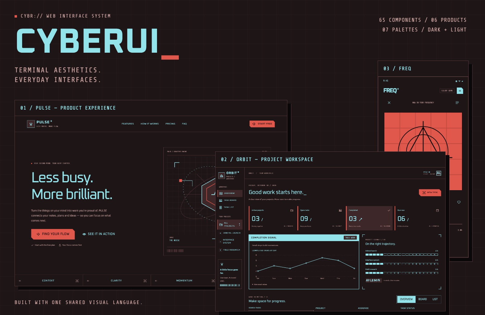
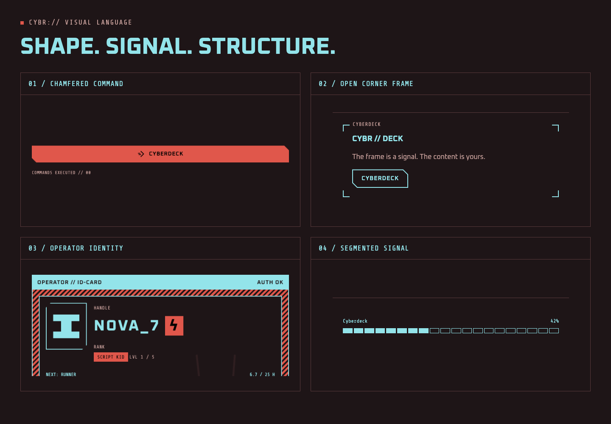
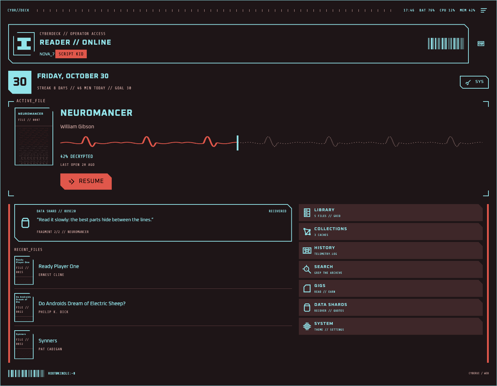
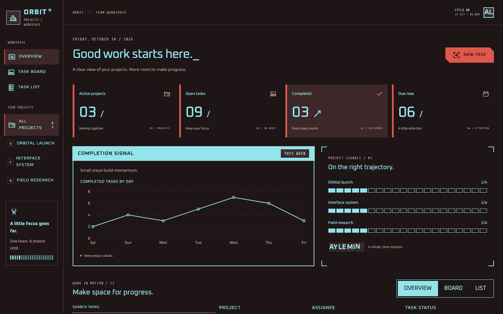
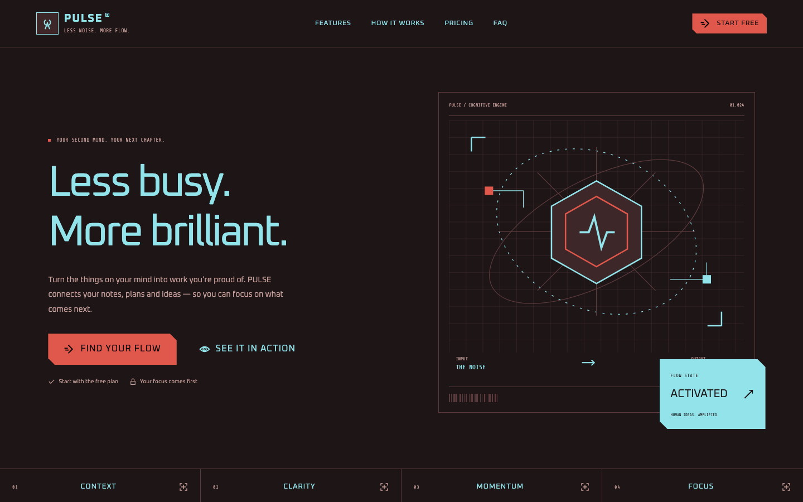
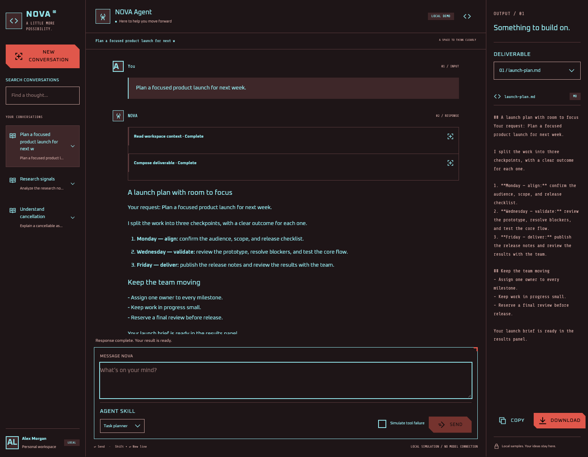
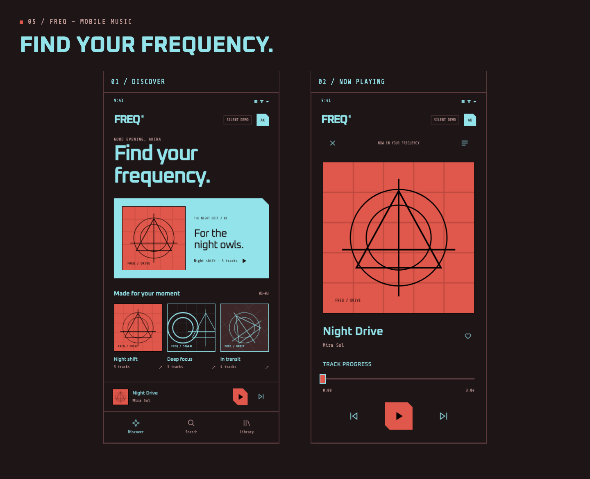
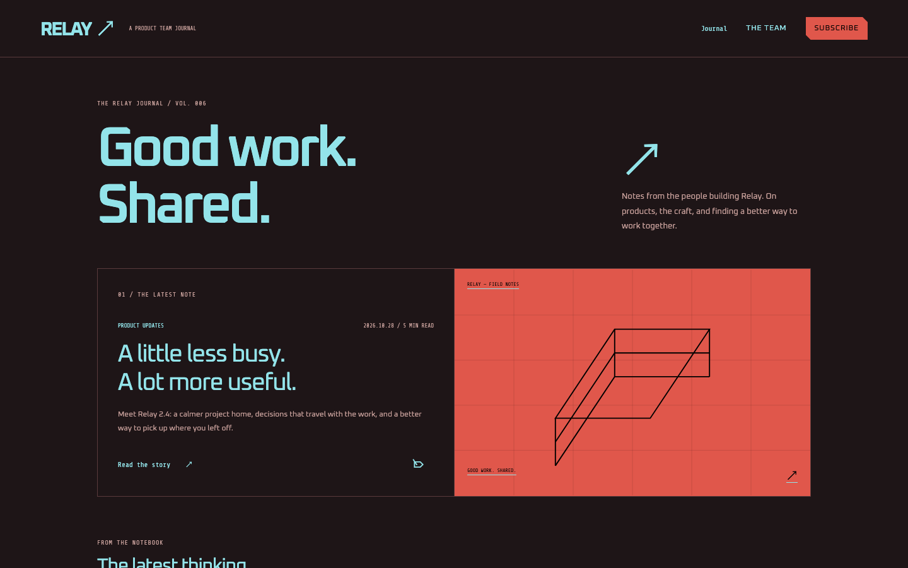
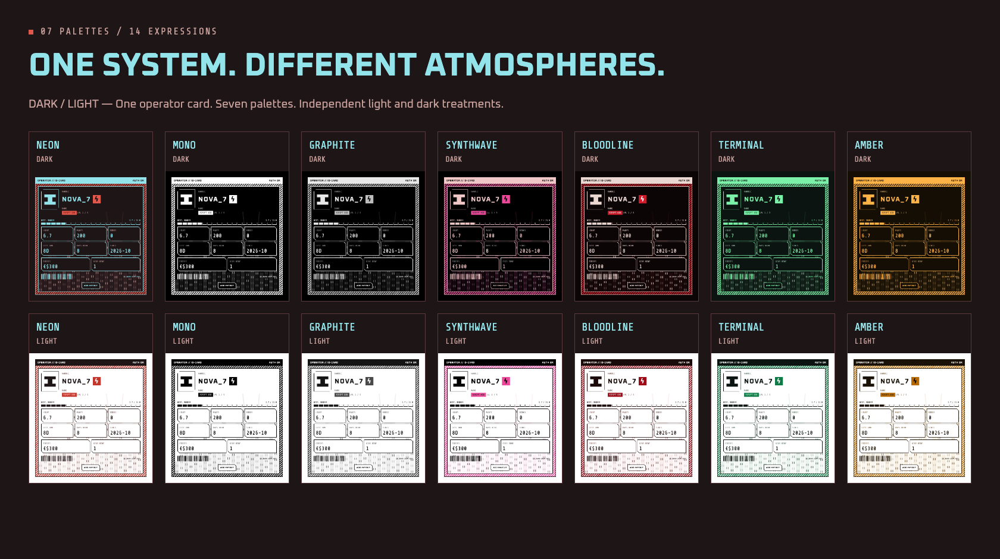
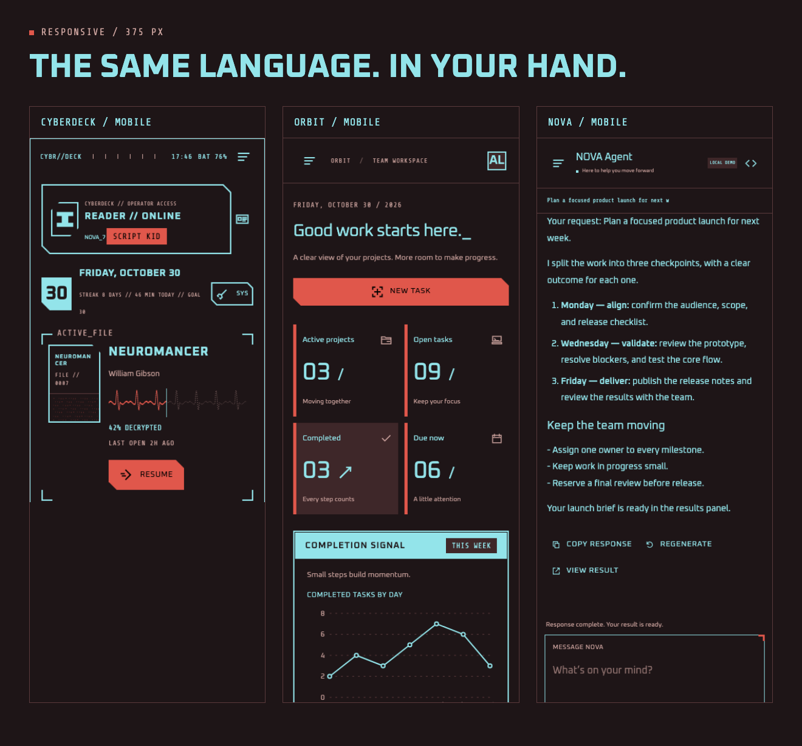

# CyberUI

**Terminal aesthetics. Everyday interfaces.**

CyberUI is a React component library and design system with the precision of a cyber terminal. Chamfered corners, open frames, offset outlines, monospaced readouts, and a restrained signal palette create a shared visual language for readers, workspaces, product websites, and mobile apps.

[Live showcase](https://arasaka-academy.github.io/CyberUI/) · [Product scenes](https://arasaka-academy.github.io/CyberUI/#/replica) · [Components](https://arasaka-academy.github.io/CyberUI/#/components) · [Theme lab](https://arasaka-academy.github.io/CyberUI/#/themes)



<p align="center"><strong>65 components · 6 product scenes · 7 palettes × light and dark · English / Simplified Chinese</strong></p>

## Design philosophy

### Character through geometry

Chamfers give commands a sense of direction. Open corner frames define regions, while fine dividers, rails, and solid surfaces establish hierarchy. These rules extend from individual controls to complete layouts, giving buttons, panels, and navigation a recognizable identity across products.

Offset outlines add depth. Barcodes, identifiers, and coordinates reinforce the terminal aesthetic. Decoration stays around edges, headings, and status areas, leaving continuous space for reading.



### Color with a purpose

The default **Neon Dark** palette pairs a warm, near-black background with cyan information and warm red actions. Muted text and dividers sit further back. Negative space and flat color fields give dense content a clear reading order.

| Visual element | Design purpose |
| --- | --- |
| Chamfers and hard edges | Give controls distinct silhouettes and directional cues |
| Open frames, rails, and fine dividers | Define regions while keeping dense layouts open |
| Offset outlines and layered borders | Add depth to selected states and signature cards |
| Cyan information and warm red actions | Separate content from primary commands |
| Oxanium headings and Share Tech Mono readouts | Distinguish prose, labels, and data with a terminal rhythm |

### One language, different densities

The reader organizes books and reading progress. The project workspace prioritizes metrics and tasks. The product homepage uses large type and generous spacing. The chat workspace brings messages, tools, and deliverables together. Shared components, colors, and typography connect them; layout and hierarchy give each product its own character.

The visual system follows familiar Web interactions: visible focus, keyboard navigation, labeled fields, clear state feedback, responsive layouts, and respect for reduced motion preferences.

## Six products, six expressions

All images below are browser captures of the current implementation. Open an image for a closer look, or follow a scene link to try the interactions.

### CYBERDECK / Reading terminal

A personal terminal for books, reading progress, logs, and identity. ASCII covers, segmented signals, and operator cards give it the character of a dedicated device, with clear divisions between reading data and everyday actions.



[Explore CYBERDECK →](https://arasaka-academy.github.io/CyberUI/#/preview/reader) · 27 internal pages covering the library, reading history, goals, and appearance settings.

### ORBIT / Project workspace

A steady grid supports dense information. Metric cards establish the overview; line charts and segmented progress reveal trends; boards and lists bring the work into focus. Open corner frames keep neighboring regions visually distinct.



[Explore ORBIT →](https://arasaka-academy.github.io/CyberUI/#/preview/dashboard) · Switch projects, edit tasks, filter work, and move between board and list views.

### PULSE / AI product homepage

The same terminal vocabulary takes on a more spacious composition. Large headlines, an orbital illustration, chamfered calls to action, and status cards establish the first impression. Features, workflows, and pricing continue the product story.



[Explore PULSE →](https://arasaka-academy.github.io/CyberUI/#/preview/product-home) · Try pricing options, the trial form, and frequently asked questions.

### NOVA / Agent chat workspace

Conversation navigation, messages, tool activity, and deliverables share one workspace. Color fields distinguish messages, while fine dividers organize context around an ongoing conversation.



[Explore NOVA →](https://arasaka-academy.github.io/CyberUI/#/preview/agent-chat) · Try locally simulated streaming responses, stop, retry, and export a result.

### FREQ / Pocket music terminal

Hard edges, record artwork, and signal readouts fit into a mobile canvas. Discover, playlists, and the player share navigation and controls, preserving a distinct visual rhythm in a compact space.



[Explore FREQ →](https://arasaka-academy.github.io/CyberUI/#/preview/mobile-app) · Try playlists, queues, favorites, and simulated playback progress. This is a silent interaction demo.

### RELAY / Product team journal

Editorial typography makes room for longer content. Large headlines establish the subject; categories and summaries support browsing; article pages connect the table of contents, body text, and related stories. Decoration stays at the edges and dividers.



[Explore RELAY →](https://arasaka-academy.github.io/CyberUI/#/preview/blog) · Read six complete bilingual sample articles and try search, bookmarks, and article navigation.

## Seven palettes, one structure

Every palette includes independently defined light and dark treatments. Geometry, typography, and hierarchy stay consistent, while backgrounds, surfaces, and text colors adapt to each mode.



| Palette | Character |
| --- | --- |
| **Neon** | Cyan and warm red: the signature cyber terminal palette |
| **Mono** | Pure black and white, emphasizing silhouette and structure |
| **Graphite** | Quiet grayscale layers for focused work |
| **Synthwave** | Magenta and pink with an electronic atmosphere |
| **Bloodline** | Deep red and warm text for a more intense composition |
| **Terminal** | Green signals on deep green: a classic terminal feel |
| **Amber** | Amber and warm orange with the warmth of vintage instruments |

[Open the theme lab →](https://arasaka-academy.github.io/CyberUI/#/themes) · Switch modes, adjust colors, and copy a theme configuration.

## From desktop to handheld

Desktop layouts use sidebars, grids, and parallel panels to show more context. Narrow layouts bring navigation into drawers and reflow content around the main actions and reading order. English and Simplified Chinese share the same layout rules, with headings and controls wrapping to fit the available space.



## Bring the design into your project

CyberUI provides React 19 and TypeScript components through a GitHub Registry. Add source directly to your project, then adapt its geometry, styling, and interactions.

```sh
pnpm dlx shadcn@4.23.0 add Arasaka-Academy/CyberUI/button#v0.3.0
```

The [source installation guide](docs/source-installation.md) covers Vite, Next.js, manual copying, and local packages. The [component catalog](https://arasaka-academy.github.io/CyberUI/#/components) includes adjustable previews, properties, and copyable examples.

To explore locally, use Node.js 22.13+ and pnpm 11:

```sh
pnpm install --frozen-lockfile
pnpm dev
```

Open the local address printed by Vite. The showcase initially uses Simplified Chinese and Neon Dark; select **EN** in the top bar for English. Use `⌘ / Ctrl K` to search the site.

| Further reading | Contents |
| --- | --- |
| [Design system](design-system/cyberui/MASTER.md) | Geometry, typography, spacing, color, and interaction rules |
| [Product scenes](docs/web-scenes.md) | Routes, interactions, and local state across all six products |
| [Styling guide](docs/styles.md) | Tailwind v4, CSS Modules, and theme variables |
| [Production readiness](docs/production-readiness.md) · [Validation](docs/validation.md) | Supported use, verification evidence, and manual acceptance boundaries |
| [Visual references](docs/reference-map.md) | Source references, page mappings, and adaptation differences |
| [Changelog](CHANGELOG.md) · [v0.3.0](docs/releases/v0.3.0.md) | Changes and release notes |

Product scenes use local demo data and interactions. NOVA generates sample responses from local templates, FREQ does not connect to an audio service, and trial and subscription forms provide local feedback. See the [scene documentation](docs/web-scenes.md) for details.

## License

Code is available under the [MIT License](LICENSE). Third-party artwork and font notices are included in [licenses](licenses/upstream-NOTICE.md) and the [font directory](public/fonts).
